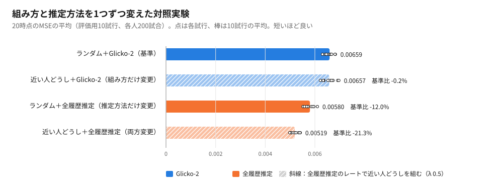
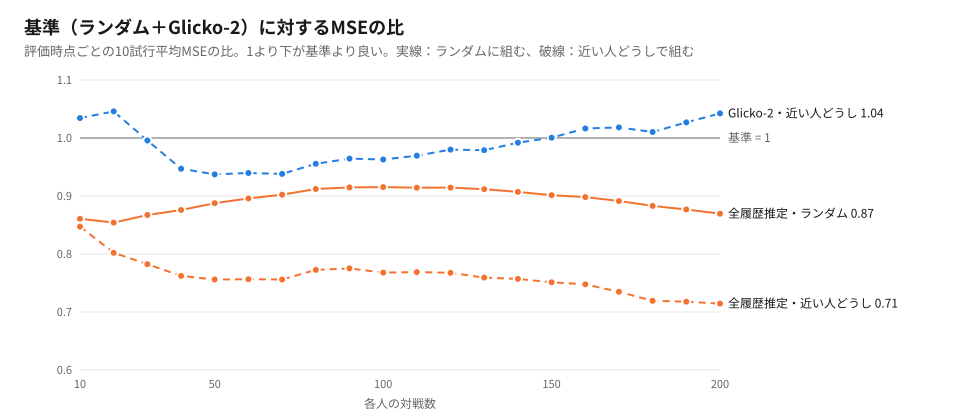
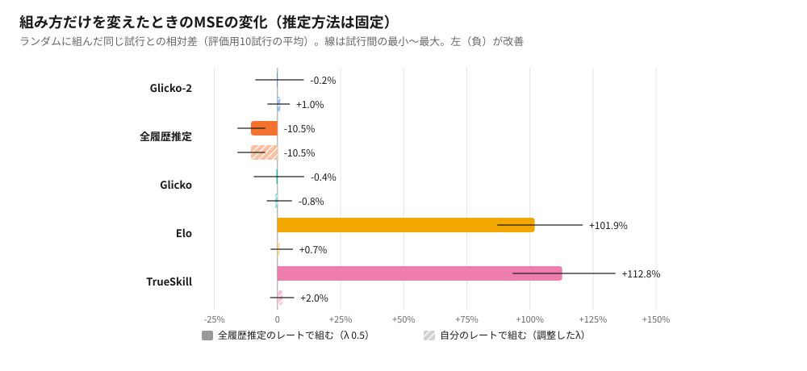
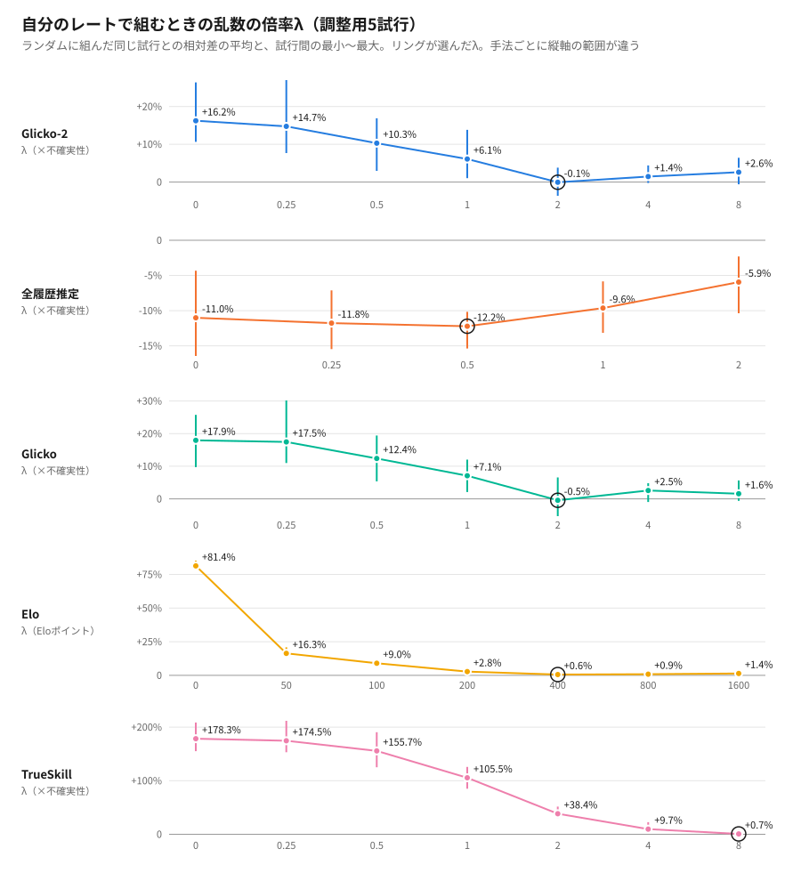

# 組み方と推定方法の対照実験

2026-11-27に行った探索の記録である。対戦の組み方（マッチング）と推定方法を1つずつ変え、どちらがMSEの改善に効くかを調べた。全履歴推定（PR #50）を使うため、PR #50の後にマージする。正式な比較実験への採用は未定で、チームで判断する。

## 結論

- **推定方法の変更は単独で効く。** ランダムに組んだまま、Glicko-2を全履歴推定に替えるとMSEが12.0%下がった（10試行すべてで改善）。
- **組み方の変更は単独では効かない。** 推定方法をGlicko-2に固定して近い人どうしを組ませても、全履歴推定のレートで組むと−0.2%、Glicko-2自身のレートで組むと+1.0%で、どちらも試行間のばらつきの範囲だった。Glickoも同様だった。
- **組み方が効くのは全履歴推定と組み合わせたときだけだった。** 全履歴推定のままランダムから近い人どうしに替えると−10.5%（10/10）。両方を替えると、基準（ランダム＋Glicko-2）より21.3%下がった（10/10）。
- **EloとTrueSkillは近い人どうしを組むと悪化した。** 全履歴推定のレートで組むと、MSEはランダムのときの約2倍（+101.9%、+112.8%）になった。自分のレートで組む場合も、乱数を大きくしてランダムに近づけるほど良くなり、ランダムより良い設定は見つからなかった。原因は調べていない。









全ての表は[集計表](results/summary.md)にある。

## 実験の構成

| 実験 | 変えるもの | runの数 |
| --- | --- | --- |
| 2×2の対照実験 | 組み方（ランダム／全履歴推定のレートで組む）×推定方法。全5手法を同じ履歴で評価する | 評価用10試行 × 2 |
| 自分のレートで組む実験 | 各手法が自分の推定レートで組み、自分を評価する。λは手法ごとに調整用で選ぶ | 調整用170、評価用50 |

自分のレートで組む実験は、2×2の組み方が全履歴推定に有利かどうかを確かめるために行った。ランダムに組む比較対象には、2×2の実験のrun 101〜110を使う。

## 条件

| 項目 | 値 |
| --- | --- |
| 生成 | 1,000人、各200試合（1ラウンドに全員1試合）、能力 N(0, 1)、`probit_1d`、`performance_std = 1` |
| 評価 | 10試合ごとの20時点のMSE（共通の `project10_evaluate`）。表の値は20時点の平均 |
| 推定 | 正式なCLI：Elo・Glicko-2は `project10_predict`、Glickoは `project10_glicko`（1500・350・`rd_growth` 0）、TrueSkillは `project10_trueskill`、全履歴推定は `project10_whole_history`（事前分布のRD 210）。更新期間は10試合 |
| ランダムに組む | 正式な生成器（`generateMatches`）の対戦をそのまま使う |
| 近い人どうしで組む | 正式な生成器のrunの `matches.csv` だけを [rematch.cpp](rematch.cpp) で作り直す。能力と正解勝率は同じ試行のランダムのrunと同一 |
| シード | 調整用5試行：基数 2026112500 + 10×試行、評価用10試行：2026113000 + 10×試行。能力・組み合わせ・勝敗に基数+1・+2・+3 |

### 組み方

毎ラウンド、全員を無作為に並べた後（同点の順を決める）、次の値の小さい順に並べ替えて隣どうしを組ませる。

> レート ＋ λ × 不確実性 × 標準正規乱数（毎ラウンド引き直す）

- レートと不確実性は、組み方に使う手法が前のラウンドまでの試合結果だけから求めた値である。真の能力は勝敗を引くときだけに使う。
- 不確実性はGlicko・Glicko-2・全履歴推定ではRD、TrueSkillではσを使う。Eloは不確実性を持たないため、λをEloポイントの標準偏差として使う。
- 期間ごとに更新する手法（Glicko・Glicko-2）は、期間の途中では期間開始時のレートで組む。全履歴推定は毎ラウンド推定し直す。
- 組み方用のGlicko-2には、正式な `glicko2.cpp` と同じ式の実装（コミット `787c686` の `glicko2_tunable`）を使う。正式な実装はrunのファイル単位でしか動かないためである。

### λの選び方

調整用5試行で候補を全て試し、20時点のMSEの平均が最小のλを選んだ。評価用10試行は選んだλでだけ実行し、結果を見て選び直していない。

- 候補：Elo以外は 0・0.25・0.5・1・2、Eloは 0・50・100・200・400（Eloポイント）。
- Elo・Glicko・Glicko-2・TrueSkillは最良が候補の端（乱数が最大）だったため、評価用を実行する前に候補を追加した（Eloは800・1600、ほかは4・8）。
- 選んだλ：Elo 400、Glicko 2、Glicko-2 2、TrueSkill 8、全履歴推定 0.5。全履歴推定の0.5は、以前の試作で同じ調整用5試行から選んだ値と同じである。

### 比較の方法

同じ試行（同じ能力・シード）どうしで相対差を取り、その平均・標本標準偏差・最小〜最大・改善した試行数を示す。

## 確認したこと

- 全240 runの設定は、[設定のテンプレート](config.template.json)と[計画](plan.sh)から作った設定とバイト単位で一致した。
- 組み方に使った推定の最終状態と、正式なCLIの200試合時点の予測を、各runの277ペアで照合した（215 run）。Elo・Glicko・TrueSkillは一致、全履歴推定は最大4.7e-11、Glicko-2は最大5.4e-7の差だった。
- 2×2で全履歴推定のレートで組んだ履歴と、自分のレートで組む実験の全履歴推定の履歴は、評価用10試行すべてでバイト単位で一致した（`matches.csv` のSHA-256）。
- このディレクトリのスクリプトでrun 201とrun 2101を新しい作業先で再実行し、MSEの120行と `matches.csv` のハッシュが一致した。集計に使ったrunは、同じ処理を行う作業用のスクリプトで実行した。

## 注意

- 組み方を変えると対戦履歴そのものが変わる。同じ履歴で推定方法を比べる主実験とは別の実験として扱う（AGENTSの公平な比較の8）。
- 2×2の組み方には全履歴推定のレートを使っているため、全履歴推定に有利な可能性がある。各手法が自分のレートで組んだ場合も、全履歴推定以外は改善しなかった。
- 生成モデルはプロビット・能力が変化しない・N(0, 1)の1条件だけである。人数や試合数、能力の分布を変えた結果はない。
- 調整したのは組み方のλと全履歴推定の事前分布のRD（210、PR #50）だけで、Elo・TrueSkill・Glicko・Glicko-2のパラメータは既定値のままである。
- 近い人どうしのrunでは `matches.csv` を差し替えているが、設定の `matchmaking` は `uniform_random` のままである。正式な生成器がほかの値を受け付けないためで、正式なrunとしては使えない。
- 計算量：全履歴推定で組む生成は、毎ラウンド推定し直すため1試行約27秒（Apple M4、1スレッド）かかった。ランダムの生成は1秒未満。

## 再現

リポジトリ直下で実行する。予測CSVは1つ約350MBになるため、[run.sh](run.sh) はMSEを出した後に予測CSVのハッシュを記録して削除する。作業先は全runで数GBになる。

```sh
bash experiments/matching_control/build.sh
WORK=/path/to/work   # リポジトリの外の作業先
for phase in factorial tuning evaluation; do
  bash experiments/matching_control/plan.sh $phase | xargs -P 6 -L 1 bash experiments/matching_control/run.sh "$WORK"
done
{
  echo "phase,run_id,trial,seed_base,matcher,lambda,estimator,matches_per_player,mse"
  for phase in factorial tuning evaluation; do
    bash experiments/matching_control/plan.sh $phase | bash experiments/matching_control/collect.sh "$WORK"
  done
} > experiments/matching_control/results/mse.csv
python3 experiments/matching_control/plot.py experiments/matching_control/results/mse.csv experiments/matching_control
```

| ファイル | 内容 |
| --- | --- |
| [rematch.cpp](rematch.cpp) | 正式な生成器のrunの対戦を、指定した手法のレートで組み直す |
| [build.sh](build.sh)・[plan.sh](plan.sh)・[run.sh](run.sh)・[check.awk](check.awk)・[collect.sh](collect.sh) | ビルド、全runの計画、1 runの実行、推定の照合、MSEの収集 |
| [plot.py](plot.py) | グラフと集計表を作る（Python標準ライブラリのみ） |
| [results/mse.csv](results/mse.csv) | 全runの評価時点ごとのMSE（生成物） |
| [results/matches_sha256.txt](results/matches_sha256.txt)・[results/predictions_sha256.txt](results/predictions_sha256.txt) | 対戦履歴と削除した予測CSVのSHA-256（生成物） |
| [results/summary.md](results/summary.md)・[figures/](figures/) | 集計表とグラフ（生成物） |

環境：macOS 26.6.2、Apple M4、Apple clang 17.0.0、CMake 4.4.4、Ninja 1.13.2。正式なCLIはReleaseビルド、`rematch` は `-O3`。コードはPR #50のコミット `497f28eb5767fc06837424cfaf8272fdaa0fd00c` から作った。
